# Diagrama entidad-relación — esquema ELECTRISYS

Generado por `oracle/docs/generar_documentacion.py` desde las claves foráneas reales de
Oracle. GitHub y VS Code (extensión Markdown Preview Mermaid) lo muestran como diagrama.

Lectura de las relaciones: `||` exactamente uno, `|o` cero o uno (FK que admite NULL),
`o{` cero o muchos. Las entidades asociativas (DETALLE_*, REPUESTO_COMPATIBILIDAD) resuelven
las relaciones N:M.

```mermaid
erDiagram
    NLP_INTENCIONES |o--o{ CONSULTAS_ASISTENTE : "intencion_detectada"
    USUARIOS |o--o{ CONSULTAS_ASISTENTE : "usuario_id"
    CLIENTES |o--o{ COTIZACIONES : "cliente_id"
    USUARIOS ||--o{ COTIZACIONES : "usuario_id"
    COTIZACIONES ||--o{ DETALLE_COTIZACIONES : "cotizacion_id (cascade)"
    REPUESTOS ||--o{ DETALLE_COTIZACIONES : "repuesto_id"
    REPUESTOS ||--o{ DETALLE_VENTAS : "repuesto_id"
    VENTAS ||--o{ DETALLE_VENTAS : "venta_id (cascade)"
    NLP_INTENCIONES ||--o{ NLP_FRASES : "intencion_id"
    NLP_FRASES ||--o{ NLP_PREDICCIONES : "frase_id (cascade)"
    NLP_INTENCIONES ||--o{ NLP_PREDICCIONES : "intencion_pred"
    PROVEEDORES ||--o{ PEDIDOS : "proveedor_id"
    USUARIOS ||--o{ PEDIDOS : "usuario_id"
    PEDIDOS ||--o{ PEDIDO_DETALLE : "pedido_id (cascade)"
    REPUESTOS ||--o{ PEDIDO_DETALLE : "repuesto_id"
    CATEGORIAS |o--o{ REPUESTOS : "categoria_id"
    PROVEEDORES |o--o{ REPUESTOS : "proveedor_id"
    REPUESTOS ||--o{ REPUESTO_COMPATIBILIDAD : "repuesto_id (cascade)"
    VEHICULOS ||--o{ REPUESTO_COMPATIBILIDAD : "vehiculo_id (cascade)"
    ROLES ||--o{ USUARIOS : "rol_id"
    CLIENTES |o--o{ VENTAS : "cliente_id"
    USUARIOS ||--o{ VENTAS : "usuario_id"
    AUDIT_LOG {
        NUMBER id PK
        NUMBER usuario_id
        VARCHAR2_100 accion
        VARCHAR2_4000 detalle
        VARCHAR2_45 ip
        TIMESTAMP created_at
    }
    CATEGORIAS {
        NUMBER id PK
        VARCHAR2_100 nombre UK
        TIMESTAMP creado_en
    }
    CLIENTES {
        NUMBER id PK
        VARCHAR2_150 nombre
        VARCHAR2_30 identificacion UK
        VARCHAR2_20 tipo_doc
        VARCHAR2_30 telefono
        VARCHAR2_150 email
        VARCHAR2_4000 direccion
        NUMBER_1 activo
        TIMESTAMP creado_en
        TIMESTAMP updated_at
        TIMESTAMP deleted_at
    }
    CONSULTAS_ASISTENTE {
        NUMBER id PK
        NUMBER usuario_id FK
        VARCHAR2_4000 texto_consulta
        VARCHAR2_50 intencion_detectada FK
        JSON entidades_json
        JSON respuesta_json
        NUMBER_1 util
        TIMESTAMP creado_en
    }
    COTIZACIONES {
        NUMBER id PK
        VARCHAR2_20 numero UK
        NUMBER cliente_id FK
        NUMBER usuario_id FK
        NUMBER_14_2 subtotal
        NUMBER_14_2 descuento
        NUMBER_14_2 impuesto
        NUMBER_14_2 total
        VARCHAR2_20 estado
        DATE vence_en
        VARCHAR2_4000 notas
        TIMESTAMP creado_en
        TIMESTAMP updated_at
    }
    DETALLE_COTIZACIONES {
        NUMBER id PK
        NUMBER cotizacion_id FK
        NUMBER repuesto_id FK
        NUMBER_10 cantidad
        NUMBER_12_2 precio_unit
        NUMBER_12_2 descuento
        NUMBER_12_2 subtotal
    }
    DETALLE_VENTAS {
        NUMBER id PK
        NUMBER venta_id FK
        NUMBER repuesto_id FK
        NUMBER_10 cantidad
        NUMBER_12_2 precio_unit
        NUMBER_12_2 descuento
        NUMBER_12_2 subtotal
    }
    LOGIN_ATTEMPTS {
        NUMBER id PK
        VARCHAR2_45 ip
        TIMESTAMP created_at
    }
    NLP_FRASES {
        NUMBER id PK
        VARCHAR2_1000 texto
        NUMBER intencion_id FK
        VARCHAR2_15 conjunto
        NUMBER_4 n_caracteres
        NUMBER_3 n_palabras
        VARCHAR2_100 fuente
        TIMESTAMP creado_en
    }
    NLP_INTENCIONES {
        NUMBER id PK
        VARCHAR2_50 nombre UK
        VARCHAR2_200 descripcion
        VARCHAR2_30 respuesta
    }
    NLP_PREDICCIONES {
        NUMBER id PK
        NUMBER frase_id FK
        VARCHAR2_30 metodo
        VARCHAR2_50 intencion_pred FK
        NUMBER_5_4 confianza
        NUMBER_1 correcta
        VARCHAR2_100 modelo
        TIMESTAMP creado_en
    }
    PEDIDOS {
        NUMBER id PK
        VARCHAR2_20 numero UK
        NUMBER proveedor_id FK
        NUMBER usuario_id FK
        VARCHAR2_20 estado
        NUMBER_14_2 subtotal
        NUMBER_14_2 total
        DATE fecha_esperada
        VARCHAR2_4000 notas
        TIMESTAMP creado_en
        TIMESTAMP updated_at
        TIMESTAMP recibido_en
    }
    PEDIDO_DETALLE {
        NUMBER id PK
        NUMBER pedido_id FK
        NUMBER repuesto_id FK
        NUMBER_10 cantidad
        NUMBER_12_2 precio_unit
        NUMBER_12_2 subtotal
    }
    POSIBLES_ERRORES {
        NUMBER id PK
        VARCHAR2_10 tipo UK
        VARCHAR2_120 error UK
        VARCHAR2_120 correcto
        NUMBER_1 nivel
        VARCHAR2_10 origen
        VARCHAR2_60 nota
        TIMESTAMP creado_en
        TIMESTAMP actualizado_en
    }
    PROVEEDORES {
        NUMBER id PK
        VARCHAR2_150 nombre
        VARCHAR2_100 contacto
        VARCHAR2_30 telefono
        VARCHAR2_150 email
        VARCHAR2_4000 direccion
        NUMBER_1 activo
        TIMESTAMP creado_en
        TIMESTAMP updated_at
        TIMESTAMP deleted_at
    }
    REPUESTOS {
        NUMBER id PK
        VARCHAR2_50 codigo UK
        VARCHAR2_200 nombre
        VARCHAR2_4000 descripcion
        NUMBER categoria_id FK
        NUMBER proveedor_id FK
        NUMBER_12_2 precio_compra
        NUMBER_12_2 precio_venta
        NUMBER_10 stock
        NUMBER_10 stock_minimo
        NUMBER_1 activo
        TIMESTAMP creado_en
        TIMESTAMP updated_at
        TIMESTAMP deleted_at
    }
    REPUESTO_COMPATIBILIDAD {
        NUMBER id PK
        NUMBER repuesto_id FK,UK
        NUMBER vehiculo_id FK,UK
        TIMESTAMP creado_en
    }
    ROLES {
        NUMBER id PK
        VARCHAR2_50 nombre UK
        TIMESTAMP creado_en
    }
    USUARIOS {
        NUMBER id PK
        VARCHAR2_100 nombre
        VARCHAR2_150 email UK
        VARCHAR2_255 password
        NUMBER rol_id FK
        NUMBER_1 activo
        TIMESTAMP creado_en
        TIMESTAMP updated_at
        TIMESTAMP deleted_at
    }
    VEHICULOS {
        NUMBER id PK
        VARCHAR2_80 marca UK
        VARCHAR2_80 modelo UK
        NUMBER_4 anio_desde UK
        NUMBER_4 anio_hasta UK
        VARCHAR2_50 motor UK
        VARCHAR2_20 combustible UK
        TIMESTAMP creado_en
    }
    VENTAS {
        NUMBER id PK
        VARCHAR2_20 numero UK
        NUMBER cliente_id FK
        NUMBER usuario_id FK
        NUMBER_14_2 subtotal
        NUMBER_14_2 descuento
        NUMBER_14_2 impuesto
        NUMBER_14_2 total
        VARCHAR2_20 metodo_pago
        VARCHAR2_20 estado
        VARCHAR2_4000 notas
        NUMBER version
        TIMESTAMP creado_en
        TIMESTAMP updated_at
    }
```

## Tablas sin relaciones declaradas (a propósito)

- **posibles_errores**: `correcto` apunta a `vehiculos.marca`, `vehiculos.modelo` o
  `categorias.nombre` según el valor de `tipo`; una FK no puede elegir destino por el valor
  de otra columna. Ver `normalizacion.md`, decisión D4.
- **audit_log.usuario_id**: sin FK para que el log sobreviva a cualquier cambio en usuarios.
- **login_attempts**: registra IPs, no usuarios (el intento puede ser de un usuario inexistente).
